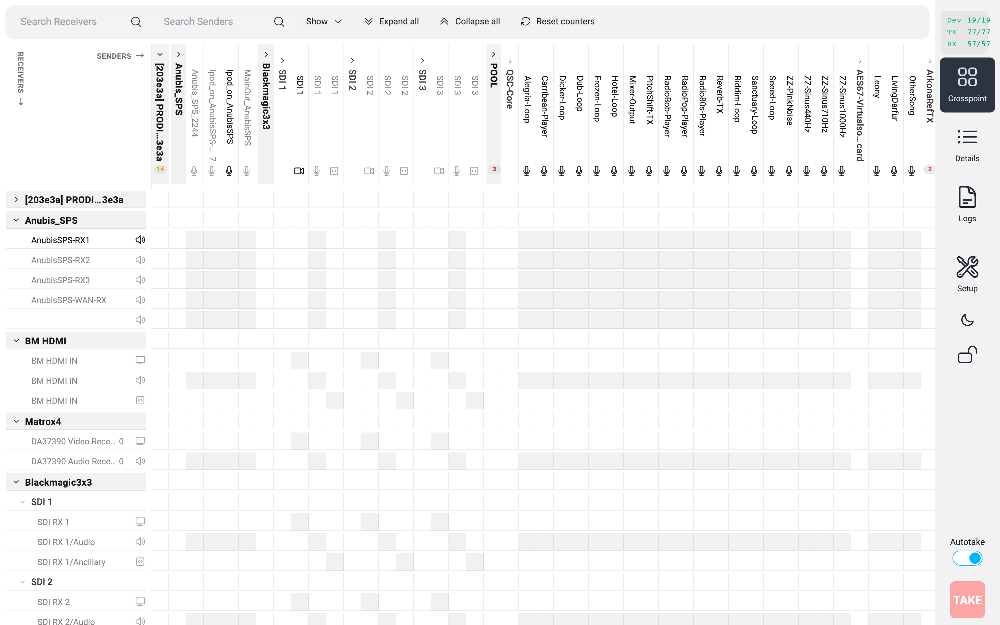
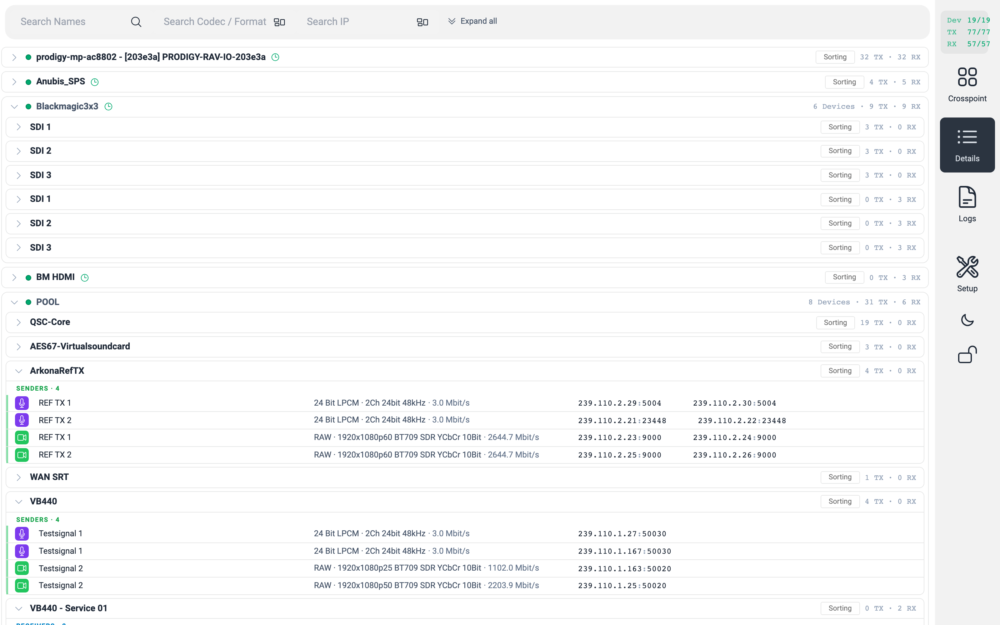
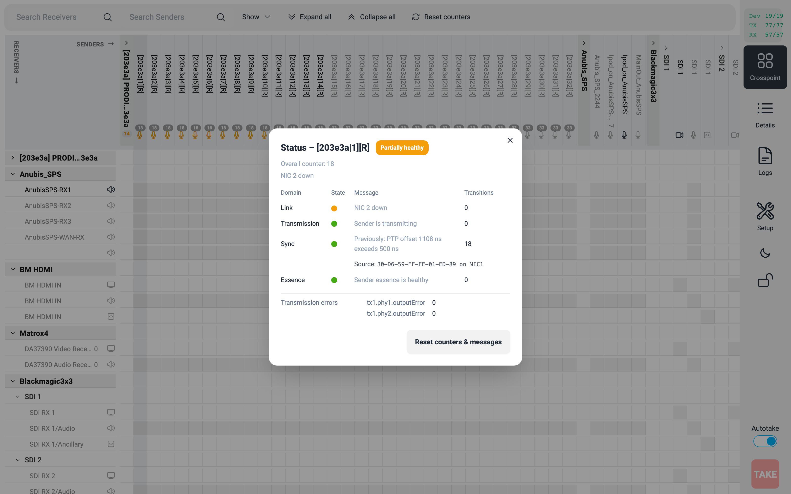
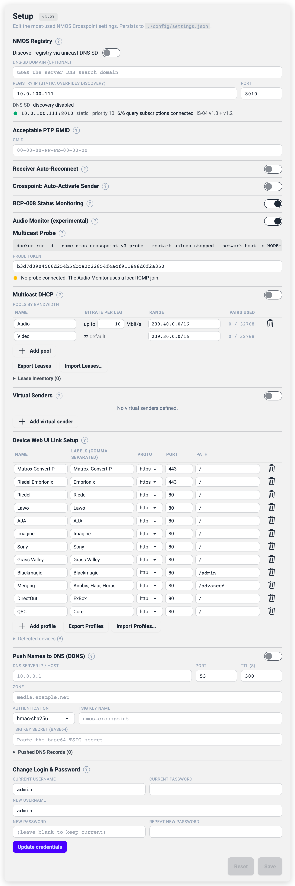

# NMOS Crosspoint

A web-based NMOS controller for ST 2110, AES67 and MXL networks: see every device, route senders to receivers like on a classic crosspoint, and let it take care of the multicast addresses.



## Features

- **Crosspoint matrix:** connect any sender to any receiver via IS-05, with autotake or stage and TAKE.
- **Details page:** every node, device, sender and receiver, live from the registry, with formats, bitrates, ST 2022-7 legs and SDP. You can search by name, format or IP.
- **Multicast DHCP:** multicast addresses from your own pools, optionally split by bandwidth. Duplicates are flagged.
- **BCP-008:** live health per sender and receiver via IS-12.
- **PTP:** a dot per device shows whether it is locked to the right grandmaster.
- **Registry discovery:** via unicast DNS-SD or mDNS, or a static address.
- **Audio monitor:** listen to any audio sender in the browser, optionally via a probe in the media network.
- **Aliases, hide, forget:** rename devices and flows, hide what you don't need, remove offline devices.
- **Virtual senders:** devices without NMOS join the matrix with their SDP.
- **Web UI links and DDNS:** open a device's own web page in one click, and push device names to your DNS server.

Tested with Lawo, Riedel, Embrionix, AJA, Imagine, Sony, Grass Valley, Blackmagic, Merging, DirectOut, QSC and Matrox, and with more than 2000 flows.





## Installation

You need an NMOS registry, for example [nmos-cpp](https://github.com/sony/nmos-cpp). A ready-made image is [rhastie/build-nmos-cpp](https://github.com/rhastie/build-nmos-cpp).

```shell
docker run -d --restart unless-stopped --network host --name nmos-crosspoint_v3 \
  -v "$(pwd)/server/config:/nmos-crosspoint/server/config" \
  -v "$(pwd)/server/state:/nmos-crosspoint/server/state" \
  gemini2350/nmos-crosspoint_v3:latest
```

Alternatively, run `docker compose up` with the `docker-compose.yml` from this repository.

Open `http://<host>` in a browser and log in with `admin` / `admin`. Then go to the Setup page and change the password. Everything else is configured there too, and the **?** next to each setting explains it.

`config` holds the settings and users; `state` holds the multicast leases, aliases and hidden flows.



## Development

In `server` and `ui`, run `npm install && npm run dev`.

## License

MIT, see [LICENSE.md](LICENSE.md).
